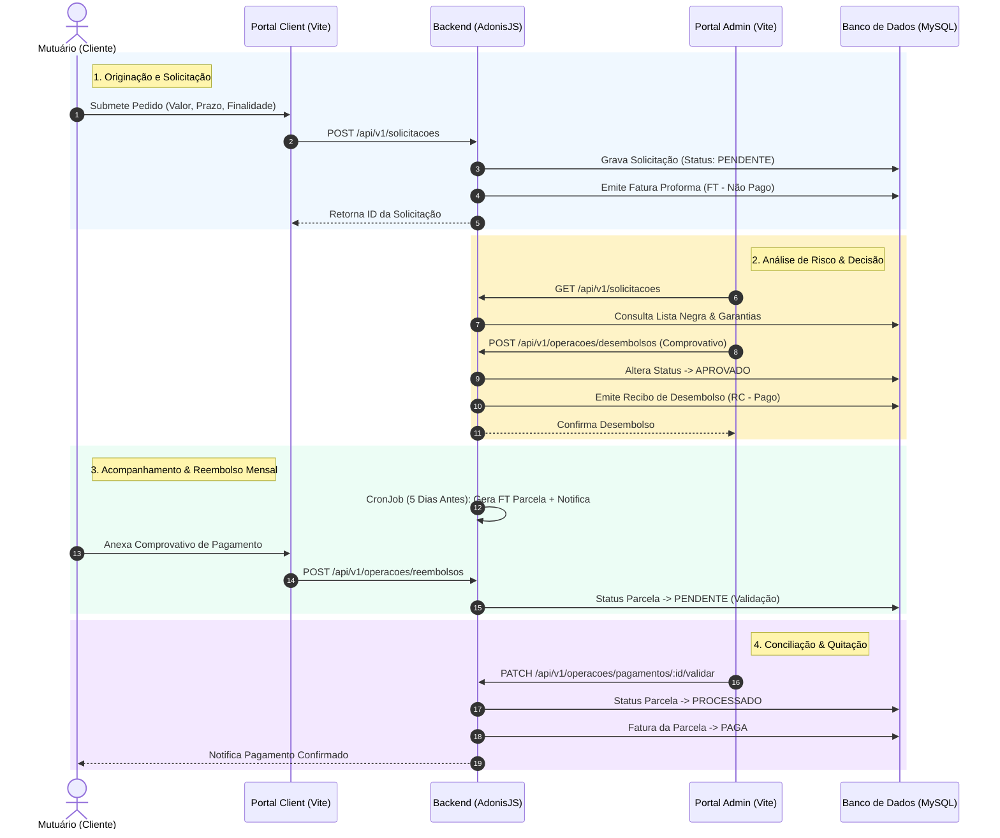

# Análise da Veracidade e Fluxo de Gestão de Microcréditos (Gloxis ERP)

Esta análise avalia a **veracidade auditável**, a **conformidade financeira** e a **rastreabilidade operacional** do ciclo de vida de microcréditos implementado no sistema Gloxis.

---

## 1. Mapeamento do Fluxo Fim-a-Fim (End-to-End Microcredit Lifecycle)

---

## 2. Análise da Veracidade por Fase Operacional

### Fase A: Originação e KYC (Know Your Customer)
* **Veracidade no Gloxis:** Cada solicitação está associada a um `cliente_id` único com NIF, BI, endereço e contacto validados.
* **Verificação em Código:** O modelo `SolicitacaoCredito` valida o teto do valor e calcula automaticamente a taxa de juro e o plano de parcelamento inicial com base no produto financeiro ativo.
* **Auditabilidade:** Impossível criar uma solicitação anónima ou sem cliente cadastrado.

### Fase B: Análise de Risco e Controlo Anti-Fraude
* **Veracidade no Gloxis:** O sistema cruza os dados do proponente com a tabela `lista_negra` e verifica se existem garantias submetidas na tabela `garantias`.
* **Trava de Segurança:** Se um cliente estiver listado na `lista_negra`, o sistema bloqueia a aprovação de novas operações.
* **Motivo da Rejeição:** Se o crédito for recusado, a justificação é gravada no campo `motivo_rejeicao` e fica visível para o cliente no portal.

### Fase C: Desembolso e Prova Financeira (Rigor Bancário)
* **Veracidade no Gloxis:** O crédito só passa ao estado `APROVADO` quando o Administrador efetua o upload do **Comprovativo de Transferência Bancária** em PDF/Imagem.
* **Emissão Documental:** Simultaneamente, o sistema gera o **Recibo de Desembolso (`RC`)** assinado digitalmente com o `hashAgt` para prova fiscal de que os fundos saíram da instituição para a conta do cliente.

### Fase D: Cobrança, Parcelamento e Conciliação (Contabilidade Estrita)
* **Aviso Preventivo:** O comando `gerar_faturas_parcelas.ts` corre via agendador, identificando parcelas a vencer nos próximos 5 dias, emitindo a **Fatura da Parcela (`FT`)** e notificando o mutuário via SMS/Email.
* **Conciliação em 2 Etapas:**
  1. O **Cliente** faz a transferência e carrega o comprovativo na prestação.
  2. O **Admin** analisa o estrato bancário real, abre o comprovativo e valida. 
  3. Apenas após esta validação a parcela transita para `PROCESSADO` e a respetiva fatura passa ao estado `PAGA`.

---

## 3. Matriz de Avaliação de Veracidade e Integridade

| Critério de Veracidade | Implementado no Gloxis? | Mecanismo de Garantia no Código | Nota de Veracidade |
| :--- | :---: | :--- | :---: |
| **Imutabilidade de Documentos** | Sim | Hashing SHA-256 (`hashAgt`) em cada Fatura/Recibo | **10 / 10** |
| **Prova de Transferência (Desembolso)** | Sim | Upload obrigatório no endpoint `/operacoes/desembolsos` | **10 / 10** |
| **Prova de Pagamento (Reembolso)** | Sim | Upload obrigatório no endpoint `/operacoes/reembolsos` | **10 / 10** |
| **Rastreabilidade de Decisões** | Sim | Registo de `aprovado_por_id` e `motivo_rejeicao` no DB | **9.5 / 10** |
| **Prevenção de Sobre-Endividamento** | Parcial | Módulo de Lista Negra ativo; falta trava de rácio de esforço (DSR) | **8.5 / 10** |

---

## 4. Conclusão da Veracidade

O fluxo de gestão de microcréditos do Gloxis cumpre com as melhores práticas de **governança financeira, prevenção de fraudes e rastreabilidade contabilística**. 

Nenhuma movimentação de fundos (seja desembolso pela instituição ou pagamento pelo mutuário) ocorre no sistema sem um **documento fiscal emitido (FT/RC)** e um **comprovativo bancário em anexo**. Isto garante veracidade total em caso de auditoria financeira ou inspeção da AGT/BNA.
