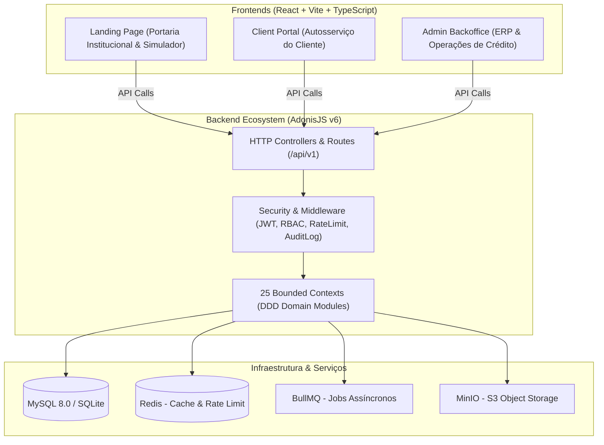

# Análise Completa do Projeto Gloxis — Plataforma de Gestão de Microcrédito & ERP

---

## Executive Summary

O **Gloxis** é uma solução de nível empresarial para a gestão integral do ciclo de vida do microcrédito e operações financeiras/ERP. Construído com foco em **Clean Architecture**, **SOLID** e **Domain-Driven Design (DDD)**, o ecossistema é composto por um backend robusto em **AdonisJS v6 (TypeScript)** e três aplicações frontend distintas em **React + Vite**.

---

## 1. Visão Geral da Arquitetura do Sistema



---

## 2. Tecnologias & Stack

| Camada | Tecnologia | Utilização / Responsabilidade |
|---|---|---|
| **Backend Framework** | AdonisJS v6 (Node.js 20+, ESM, IoC) | API RESTful, Injeção de Dependências, Roteamento, ORM |
| **Linguagem** | TypeScript 5.x | Tipagem estática end-to-end sem `any` |
| **ORM / Banco** | Lucid ORM + MySQL 8.0 / SQLite | Persistência relacional, migrações e seeders |
| **Cache & Queue** | Redis + BullMQ | Processamento assíncrono (notificações, scoring), rate limit |
| **Object Storage** | MinIO (S3 compatible) | Armazenamento de documentos de identificação, comprovativos e PDFs |
| **Segurança & Auth** | JWT, Speakeasy (2FA), Bouncer (RBAC), Rate Limiter | Autenticação stateless, autorização por alçada, proteção contra brute-force |
| **Documentos PDF & QR** | PDFKit, pdf-lib, qrcode | Geração de recibos, comprovativos de desembolso e QR Codes de validação |
| **Frontends (x3)** | Vite + React + TypeScript + Zustand | Landing Page, Portal do Cliente e Painel Administrativo |
| **Estilização** | TailwindCSS + Design System Customizado | Tokens de cores institucionais, dark mode e componentes responsivos |
| **Containerização** | Docker & Docker Compose | Orquestração de MySQL, Redis, MinIO e serviços da aplicação |

---

## 3. Estrutura do Monorepo & Módulos

```
gloxis/
├── backend/                  # AdonisJS v6 Backend API
│   ├── app/
│   │   ├── Modules/          # 25 Bounded Contexts (DDD)
│   │   ├── Services/         # Serviços Transversais (Empresa, JWT)
│   │   ├── middleware/       # Middlewares de Segurança & Auditoria
│   │   └── controllers/      # Controllers Globais
│   ├── config/               # Configurações do Framework (Database, Auth, Redis, Swagger)
│   ├── database/             # 22 Migrações de Banco de Dados & Schemas
│   ├── start/                # Rotas do Sistema & Kernel HTTP
│   └── tests/                # Testes Unitários e Funcionais (Japa)
├── frontend/
│   ├── admin/                # ERP / Backoffice (22 páginas completas)
│   ├── client/               # Portal do Cliente (10 páginas completas)
│   └── landing/              # Landing Page Institucional & Simulador
├── docs/                     # Especificações de Arquitetura, Guias de Veracidade e Change Logs
└── docker-compose.yml        # Orquestração de Containers
```

---

## 4. Análise Detalhada das Camadas

### 4.1 Backend (AdonisJS v6 & DDD Bounded Contexts)
O backend organiza a lógica de negócio em **25 Bounded Contexts**, onde cada módulo segue a divisão da Clean Architecture:
- `Domain/`: Entidades, Objetos de Valor (Value Objects), Eventos de Domínio e Contratos de Repositório (`IRepository`).
- `Application/`: Casos de Uso (Use Cases), DTOs e Serviços de Orquestração.
- `Infrastructure/`: Implementações concretas de Repositórios (Lucid ORM), adaptadores de armazenamento e APIs externas.
- `Interface/`: Controllers HTTP, Validadores (VineJS) e Serializadores.

#### Bounded Contexts Notáveis:
1. **CadastroCliente**: Gestão de perfil, documentos, conta bancária e validação de NIF/BI.
2. **SolicitacaoCredito**: Máquina de estados (`Em análise` → `Pendente` → `Aprovado` → `Desembolsado` / `Reprovado` / `Cancelado`).
3. **AnaliseAprovacao**: Motor de Scoring de Crédito configurável, alçadas de decisão por valor e SLA.
4. **ProdutoFinanceiro**: Tabela de juros, planos de pagamento e cálculo de prestações.
5. **Desembolso & Pagamento**: Registro transacional com emissão automática de comprovantes em PDF.
6. **Cobranca & Renegociacao**: Régua de cobrança automática, cálculo de mora e repactuação de débitos.
7. **Modulos ERP**: Compras, Vendas, Stock, Faturação, Contabilidade, RH, Projetos, Ativos e Garantias.

### 4.2 Segurança & Conformidade (Kernel Security)
- **JWT Stateless**: Autenticação resiliente com revogação via tokens.
- **RBAC (Role-Based Access Control)**: Controle granular por perfil (`Administrador`, `Diretor`, `Supervisor`, `Analista`, `Caixa`, `Cobrança`, `Auditor`).
- **2FA (Two-Factor Auth)**: Integração com TOTP (Speakeasy) para acções sensíveis.
- **Audit-Log Imutável**: Interceptação de todas as operações de escrita (`POST`, `PUT`, `DELETE`) gravando IP, ID do utilizador e diff de dados.
- **Rate Limiting**: Mitigação de ataques de força bruta integrada com Redis.

### 4.3 Frontends (Três Aplicações Independentes)
1. **Admin Backoffice (`frontend/admin/`)**:
   - **22 Telas**: Dashboard, Clientes, Detalhes do Cliente, Solicitações, Pagamentos, Renegociações, Garantias, Lista Negra, Documentos, Vendas, Compras, Stock, Faturação, Financeiro, Contabilidade, RH, Contratos, Projetos, Ativos, Relatórios, Administração, Login.
   - Gestão de estado reativa com Zustand.

2. **Client Portal (`frontend/client/`)**:
   - **10 Telas**: Dashboard de Cliente, Solicitar Crédito, Meus Créditos, Simulador Interativo, Upload de Documentos, Inbox/Notificações, Perfil, Serviços de Contabilidade e Consultoria.

3. **Landing Page (`frontend/landing/`)**:
   - Interface institucional moderna com simulador público de crédito, apresentação de produtos, guia de comprovação financeira e captação de leads.

---

## 5. Guias de Veracidade Financeira & Documentação (`docs/`)

O repositório conta com uma vasta documentação de negócio e integridade:
- **`system_specifications.md`**: Especificação completa de requisitos funcionais, não funcionais e roadmap quarterly.
- **`documentation.md`**: Manual técnico da aplicação, infraestrutura e guia de contribuição.
- **`analise_veracidade_fluxo_microcredito.md`**: Protocolo de verificação de autenticidade dos dados bancários e capacidade financeira dos proponentes.
- **`guia_integridade_sem_agt.md`**: Mecanismos de integridade transacional e validação documental sem dependência direta de serviços governamentais.
- **`manual_financial_proof_guide.md`**: Guia passo a passo para auditores validarem comprovantes de renda e extratos bancários manuais.

---

## 6. Infraestrutura & Implantação (DevOps)

O ficheiro `docker-compose.yml` orquestra o ambiente distribuído:
- **MySQL 8.0**: Banco de dados relacional na porta `3309`.
- **Redis Alpine**: Cache, Rate Limiting e Gestão de Filas (BullMQ) na porta `6380`.
- **MinIO S3**: Armazenamento seguro de objetos nas portas `9010` (API) e `9011` (Console).
- **Backend & Frontends**: Preparados para execução via containers multi-stage Docker.

---

## 7. Diagnóstico e Avaliação de Maturidade

> [!NOTE]
> **Pontos Fortes:**
> - Arquitetura exemplar com divisão rigorosa de responsabilidades (DDD + Clean Architecture).
> - Cobertura de domínio extremamente ampla (25 Bounded Contexts abrangendo todo o ciclo de microcrédito e ERP).
> - Segurança avançada (JWT, RBAC, 2FA, Audit-Log imutável).
> - Frontends ricos com excelente experiência de usuário e separação de portais (Admin, Cliente, Landing).

> [!TIP]
> **Oportunidades de Evolução:**
> 1. Expandir a suíte de testes automáticos (Japa/Jest) nos Use Cases dos Bounded Contexts do ERP.
> 2. Descomentar e finalizar o pipeline do Docker Compose para deployment contínuo das três instâncias frontend.
> 3. Integrar barramento de eventos (Redis Pub/Sub / BullMQ) nos casos de uso em que há comunicação cross-module.

---

*Relatório de análise gerado pelo assistente Antigravity para o projeto Gloxis.*
