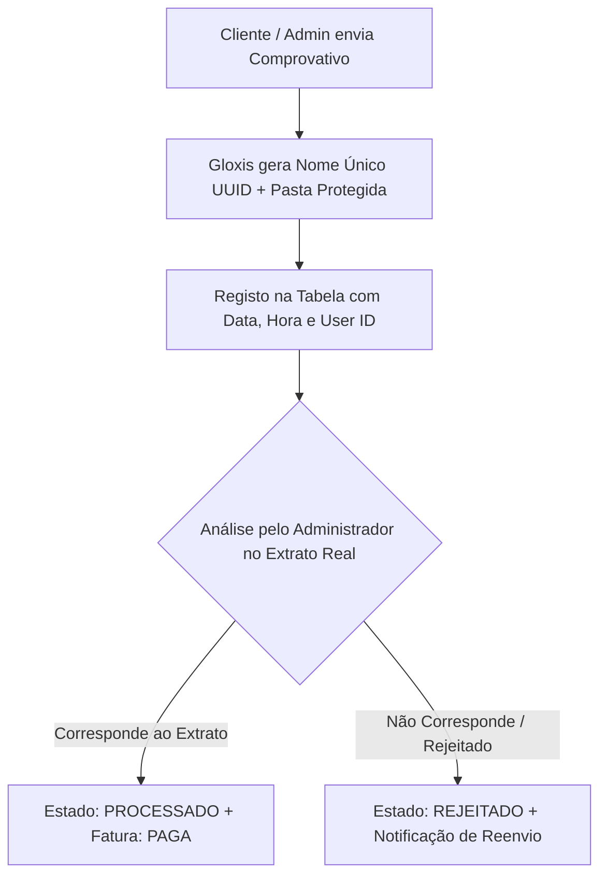

# Guia de Veracidade e Emissão Documental Interna (Sem Integração Direta AGT)

Quando um sistema ERP / Microcrédito opera de forma interna sem ligação direta via webservices a software certificado da AGT, a **validade contabilística e veracidade perante auditores** é garantida por **Mecanismos de Integridade Criptográfica e Validação Interna**.

---

## 1. Como o Gloxis Garante a Veracidade dos Recibos e Faturas

Mesmo sem WebServices AGT ativos, o Gloxis emite documentos formais com o mesmo rigor de um sistema contabilístico profissional:

### A. Numeração Sequencial Única e Contínua
* **Formato Profissional:** `RC 2026/000001` (Recibo de Desembolso / Quitação) e `FT 2026/000001` (Fatura Proforma / Cobrança).
* **Imutabilidade:** O sistema não permite apagar registos de faturas emitidas. Caso haja um cancelamento, o estado transita para `CANCELADO`, mantendo a numeração sequencial sem lacunas.

### B. Assinatura de Integridade (Hash SHA-256 Interno)
* Na criação de cada fatura ou recibo, o Gloxis calcula um **Hash Digest Criptográfico SHA-256** utilizando:
  $$\text{Hash} = \text{SHA256}(\text{Data} + \text{NIF Cliente} + \text{Valor} + \text{ID Documento})$$
* **Utilidade do Hash:** O Hash é impresso no rodapé de cada PDF. Se alguém tentar alterar manualmente o valor ou o nome na base de dados, a chave hash deixará de bater certo, comprovando a adulteração.

### C. Carimbo Visual de Estado e Layout Profissional (A4)
* Cada PDF gerado possui um **Carimbo de Estado**:
  * 🟢 **`PAGO / CONCILIADO`** (Para Recibos RC após confirmação de transferência).
  * 🟠 **`PENDENTE / NÃO PAGO`** (Para Faturas FT emitidas e a aguardar pagamento).
* **Rodapé de Auditoria:** Contém o aviso formal:
  > *"DOCUMENTO DE CONTROLO INTERNO E CONCILIAÇÃO FINANCEIRA - GLOXIS ERP. Validação de Integridade (Hash SHA-256): [HASH]"*

---

## 2. Como Garantir a Veracidade dos Comprovativos Carregados (Uploads)

Para evitar fraudes no carregamento de ficheiros (ex: clientes que enviam comprovativos falsos, duplicados ou de outras operações):

### Regras de Veracidade para Uploads:

1. **Proteção contra Ficheiros Duplicados / Sobrescritos:**
   * O sistema altera o nome de cada ficheiro carregado para uma chave única (`UUID`), armazenando em `/public/uploads/comprovativos/`. Ninguém consegue sobrescrever comprovativos antigos.

2. **Princípio do Duplo Visto (Maker-Checker):**
   * Nenhum comprovativo carregado pelo cliente dá o valor como "pago" automaticamente.
   * O comprovativo entra como `PENDENTE (Aguarda Validação)`.
   * Apenas um gestor com permissões de Admin, após verificar o extrato bancário institucional, pode clicar em **"Validar Pagamento"**.

3. **Inviolabilidade do Registo de Aprovação:**
   * Quando o gestor aprova, o sistema grava o `aprovado_por_id` e a `data_pagamento` exata no banco de dados.

---

## 3. Matriz da Documentação Gerada pelo Gloxis

| Operação | Documento Emitido no Gloxis | Tipo | Carimbo |
| :--- | :--- | :---: | :---: |
| **Solicitação de Crédito Criada** | Fatura Proforma / Cobrança | `FT` | 🟠 PENDENTE |
| **Desembolso do Crédito Efetuado** | Recibo de Liquidação / Desembolso | `RC` | 🟢 PAGO / CONCILIADO |
| **Emissão de Parcela (Mês X)** | Fatura da Parcela | `FT` | 🟠 PENDENTE |
| **Validação da Parcela pelo Admin**| Atualização da Fatura da Parcela | `FT` | 🟢 PAGO / CONCILIADO |

Com este padrão, a tua empresa tem **controlo financeiro total, rastreabilidade fiscal interna e provas irrefutáveis para qualquer auditoria**!
