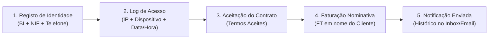

# Guia de Comprovação Financeira e Rastreabilidade do Cliente sem Gateway Automático

Quando um sistema de microcrédito opera sem um gateway de pagamento automático (como a API do Multicaixa Express / EMIS), a **validade jurídica e a prova contabilística** assentam num modelo de **Conciliação Documental Cruzada**.

---

## 1. Como Comprovar as Transferências Financeiras (Sem Gateway)

Sem pagamentos automáticos, o fluxo apoia-se em **Comprovativos Bancários Oficiais + Recibos com Hashing AGT**.

### A. Transferência da Empresa para o Cliente (Desembolso do Crédito)
1. **Onde é feito o pagamento:** O gestor abre o aplicativo do banco da empresa (ex: BAI Directo, BFA Net, Atlântico Online) ou vai ao caixa bancário e faz a transferência para o IBAN do cliente.
2. **Obtenção da Prova:** O banco gera um **Comprovativo Oficial de Transferência** (PDF/JPG) que contém:
   * Nº da Transação / Referência Bancária
   * IBAN de Origem (Empresa) e IBAN de Destino (Cliente)
   * Nome e NIF do Beneficiário
   * Valor Exato (ex: 200.000,00 Kz)
3. **Registo na Plataforma Gloxis:** O gestor faz o upload deste comprovativo no Gloxis ao clicar em **"Aprovar & Efetuar Desembolso"**.
4. **Geração do Recibo (RC):** O Gloxis gera o **Recibo de Desembolso (`RC`)** com o hash AGT, vinculando o número da solicitação ao comprovativo do banco.
5. **Resultado da Prova:** Em qualquer auditoria ou tribunal, a prova é irrefutável porque cruza:
   $$\text{Extrato Bancário do Banco} + \text{Comprovativo Anetado} + \text{Recibo RC do Gloxis}$$

---

### B. Pagamento das Prestações pelo Cliente (Reembolso do Crédito)
1. **Onde o Cliente Paga:** O cliente faz a transferência via Multicaixa Express, ATM ou balcão bancário para a conta da empresa Gloxis.
2. **Carregamento da Prova pelo Cliente:** No portal `Meus Créditos`, o cliente clica na prestação do mês X e carrega a fotografia ou PDF do talão do Multicaixa/Transferência.
3. **Validação Manual pelo Gestor (Conciliação):**
   * O gestor abre a página de `Pagamentos` no Admin.
   * Abre o extrato real da conta bancária da empresa e confirma se a quantia deu entrada na conta.
   * Clica no botão **"Validar Pagamento"**.
4. **Registo de Auditabilidade:** O sistema altera o estado da parcela para `PROCESSADO`, regista a data/hora exata e grava o ID do gestor que validou (`aprovado_por_id`).

---

## 2. Como Comprovar que o "Cliente X" Utilizou a Plataforma

Para garantir validade jurídica e evitar alegações de *"eu nunca pedi este crédito"* ou *"alguém usou a minha conta"*, o Gloxis regista um **Rasto Digital Completo (Audit Trail)**:

### Elementos de Prova no Banco de Dados Gloxis:

1. **Dados de Identificação Única (KYC):**
   * Tabela `clientes`: Guarda o Nome Completo, NIF, Número do BI e endereço.
   * Impossível haver solicitações sem conta de cliente registada.

2. **Logs de Auditoria de Sessão e IP:**
   * Sempre que o cliente faz login, solicita um crédito ou carrega um comprovativo, o sistema regista na base de dados o **Endereço IP**, o **Data/Hora (Timestamp Luxon)** e o navegador utilizado.

3. **Contrato de Microcrédito e Aceitação Digital:**
   * Na submissão da solicitação, o formulário regista o consentimento explícito do cliente relativamente ao valor, taxa de juro e plano de amortização.

4. **Faturas Nominativas com Hash AGT:**
   * A **Fatura Proforma (`FT`)** emitida na criação da solicitação é gravada com o NIF e Nome do cliente e o HASH SHA-256 legal da AGT.

5. **Histórico de Notificações Recebidas:**
   * O histórico de mensagens enviadas para o cliente fica registado na tabela `notificacoes` com a data e o conteúdo exato do aviso de vencimento.

---

## 3. Resumo Prático para o Dia-a-Dia da Empresa

| O que quer comprovar? | Ficheiro / Prova Física | Registo de Prova no Gloxis |
| :--- | :--- | :--- |
| **Que entregou o dinheiro ao cliente** | Comprovativo em PDF do BAI/BFA/BIC | Recibo `RC` em PDF + Ficheiro na pasta `/uploads/comprovativos` |
| **Que o cliente pagou a prestação** | Talão do Multicaixa Express enviado pelo cliente | Estado `PROCESSADO` na tabela `pagamentos` + ID do Gestor que validou |
| **Que o cliente pediu o crédito** | Extrato de IP + Aceitação do Pedido | Fatura `FT` em nome do cliente com NIF + Registo na tabela `solicitacao_creditos` |
| **Motivo de ter rejeitado um cliente** | N/A | Campo `motivo_rejeicao` gravado na tabela |

Com esta arquitetura de conciliação cruzada, **a empresa possui cobertura legal e contabilística total**, dispensando obrigatoriedade imediata de gateway automático!
